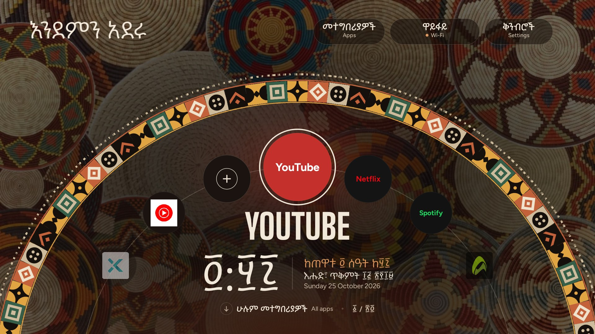

# HabeshaTV

A Habesha home screen for Android TV: your apps on a ring like a **mesob** (the woven basket table), Amharic first with English beneath, and the Ethiopian calendar and clock. Built on **[CleanYourTV](https://github.com/Gathin23/cleanyourtv)**, which strips the factory bloat off your TV over Wi-Fi.



This repository starts from a copy of CleanYourTV ([MIT](LICENSE), commit `c1946b5`): the `launcher/`, `tools/`, `themes/` and the Mi Box S reference lists are still here. HabeshaTV **adds** a new home screen to the launcher and leaves the original in place. No root, nothing uninstalled, and every change is reversible.

## How it differs

| | [CleanYourTV](https://github.com/Gathin23/cleanyourtv) | **HabeshaTV** (this) |
|---|---|---|
| Home screen | Dock and grid | Apps on a ring, like a mesob |
| Language | English (and many translations) | **Amharic first**, English beneath |
| Clock | Normal 12/24-hour | **Ethiopian hours**: 7:00 pm shows as 1:00, because the day starts at dawn |
| Calendar | Gregorian | Ethiopian date next to the Gregorian one |
| Numerals | Latin | Ge'ez numerals (፩ ፪ ፫) or plain digits, your choice |
| Look | Glass dock, themes | Woven *tilet*-style patterns, four looks, optional wallpaper |
| Screensaver | Clock | A still clock inside a woven ring |

## Features

**Home screen**
- Apps sit on a ring; Left and Right turn it, OK opens the app, Down opens **All apps**, Up reaches three buttons: **Apps**, **Wi-Fi** (your network name and signal) and **Settings**.
- A greeting that follows the time of day: እንደምን አደሩ, እንደምን ዋሉ, እንደምን አመሹ.
- **Hold OK** on an app for a menu: **Move**, **Remove**, **Theme**, **Numbers** and **Brightness**.
- An app library: one press adds a removed app back to the ring.
- After 60 idle seconds, a still screensaver with the Ethiopian clock and both dates.

**Habesha details**
- The Ethiopian calendar (13 months) and the Ethiopian 12-hour clock, tested against known dates such as Meskel, Genna and Adwa Day.
- Ge'ez numerals, the Menbere typeface for Amharic, and woven patterns drawn in code.

**Four looks and per-device settings**
- `mesob` (with a wallpaper photo), `tilet`, `lalibela` and `buna`.
- **Numbers**: Ge'ez or plain digits. **Brightness**: how much of the wallpaper shows through the dark layer behind the text.
- Settings are saved on the TV you change them on, so two TVs can look different.

**Light on a small stick**
- Drawn directly on a canvas, with no layouts. The release build is about 1.2 MB, and the fonts are cut down to the characters used.
- Unit tests cover the calendar and clock, the navigation and the Ethiopian digits.

## Tested on

| Device | Android | Result |
|---|---|---|
| Xiaomi Mi Box S (`MIBOX4`) | 9 | Works as the home screen, and survives a reboot |
| Xiaomi Mi TV Stick (`MiTV-AFKR0`) | 11, Google TV | Installs and runs. Google's launcher and setup wizard still own the Home button and boot, so it doesn't replace Home (see below) |

## Quickstart

You need an Android TV with debugging on (Settings → Device Preferences → About → press OK on **Build** seven times → Developer options → USB debugging), a computer on the same Wi-Fi, `adb`, JDK 17 or newer, and the Android SDK with platform 34.

1. **Back up first**, so you can always return to stock:

```bash
adb connect <TV_IP>:5555
adb shell pm list packages -f -u > packages_before.txt
```

2. **Build and install:**

```bash
cd launcher
./gradlew assembleRelease
adb install -r app/build/outputs/apk/release/app-release.apk
```

3. **Let it show the Wi-Fi name** (optional):

```bash
adb shell pm grant com.gathin.tvhome android.permission.ACCESS_FINE_LOCATION
```

4. **Make it Home** on an Android TV 9 stick by switching the stock launcher off (the package name differs per TV; check it in your backup):

```bash
adb shell pm disable-user --user 0 com.google.android.tvlauncher
```

### Google TV (Android 10 and newer): read this first

On Google TV the setup wizard (`com.google.android.tungsten.setupwraith`) also answers the Home button and outranks any launcher you install, so step 4 alone opens a black recovery screen. The only way around it is disabling the wizard, which the CleanYourTV notes warn can erase the saved Wi-Fi network and, on one TV, led to a factory reset after a reboot on that screen. See [`docs/TROUBLESHOOTING.md`](docs/TROUBLESHOOTING.md) before you try, and if the screen goes black, **re-enable the stock launcher and don't reboot**.

## Undo

```bash
adb shell pm enable --user 0 com.google.android.tvlauncher
adb uninstall com.gathin.tvhome
```

## Make it yours

The design is plain code you can change. The colours and looks live in `HabeshaTheme.java`, the Amharic text in `HabeshaStrings.java`, the calendar and clock in `Ethiopic.java`, and the drawing in `HabeshaHomeView.java`. After adding Amharic words, run `tools/build_fonts.py` to rebuild the fonts. [`docs/HABESHATV.md`](docs/HABESHATV.md) has the design notes and status.

## Credits and licence

- Built on **[CleanYourTV](https://github.com/Gathin23/cleanyourtv)** by Gathin and its contributors, MIT licensed. The original licence and copyright are kept in [LICENSE](LICENSE).
- Fonts: Menbere, Figtree and Big Shoulders Display (SIL Open Font License; see `launcher/FONT-LICENSE-HABESHA-OFL.txt`), plus Outfit from the original launcher.
- The basket wallpaper photograph is the author's own.
- The package name `com.gathin.tvhome` is kept from the original project so the two stay compatible.
